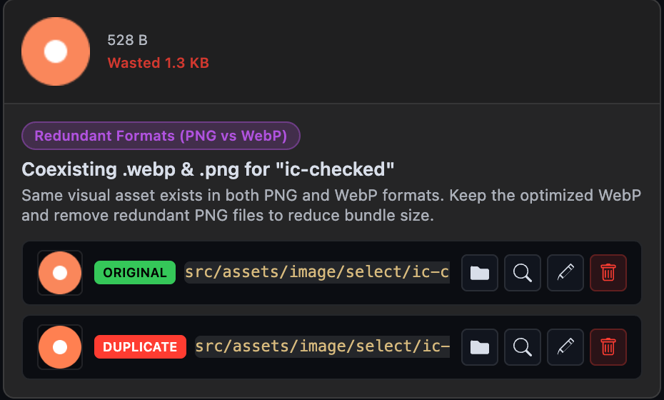
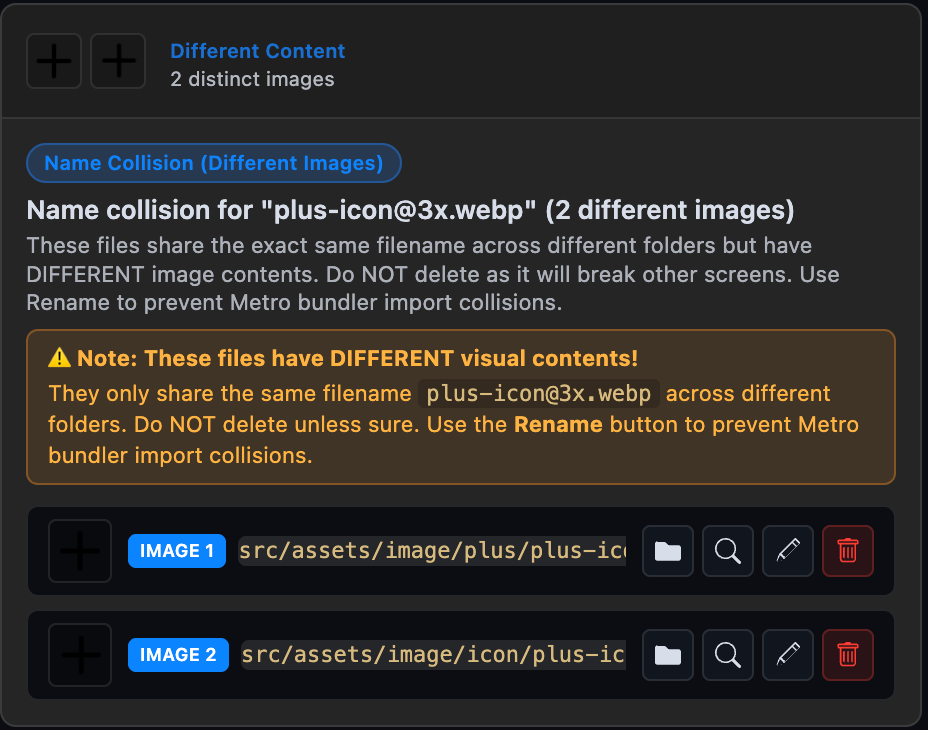

# React Native Asset & Icon Lens (`vscode-rn-asset-lens`)

<p align="center">
  
</p>

<p align="center">
  <b>The ultimate all-in-one developer companion for React Native & Expo:</b><br />
  Lightning-fast offline icon picker, smart auto-imports, image hover previews (dimensions, file size, @2x/@3x scales), in-editor gutter thumbnails, duplicate asset audits, color space & bit-depth verification, and real-time asset path diagnostics.
</p>

<p align="center">
  <b>English</b> | <a href="README.vi.md"><b>Tiếng Việt</b></a>
</p>

---

## 🚀 Problem & Solution

| Common React Native Pain Point | `vscode-rn-asset-lens` Solution |
| :--- | :--- |
| **Time wasted looking up Icons:** Switching to browser, searching icon websites, copying names, typing `<Ionicons name="..." />`, then manually adding import statements. | **Offline Visual Icon Picker & QuickPick:** Press <kbd>Cmd+Shift+I</kbd> to open the Visual Icon Explorer or <kbd>Cmd+Alt+I</kbd> for instant Quick Search. Selecting an icon **automatically inserts JSX** and **smartly merges/creates `import`** statements! |
| **No image metadata when coding:** `require('./assets/logo.png')` gives no clue about image dimensions (width × height), file size in KB, or retina scales. | **Image Hover Tooltip & Gutter Thumbnail:** Hovering over any `require('...')` instantly displays **visual preview**, **Width × Height px**, **file size**, format, and a detailed @1x/@2x/@3x scale comparison table. Plus micro thumbnails right in the line number gutter! |
| **Assets only exported as @2x/@3x or prefixed with `@2x_`:** Designers export `@2x_icon.png` or only `@3x`, and code requiring `./icon.png` throws "file not found". | **Smart Asset Resolution:** Automatically matches suffixes (`icon@2x.png`), prefixes (`@2x_icon.png`), and extensionless paths (`require('./icon')`) following React Native Metro bundler conventions. |
| **Broken asset paths only caught at runtime:** Misspelling `./assets/loggo.png` leads to runtime app crashes or blank screens in production. | **Real-time Diagnostics & QuickFix:** In-editor warning squiggly lines with fuzzy matching suggestions and a QuickFix (<kbd>Cmd+.</kbd>) to replace broken paths immediately. |
| **Duplicate images bloating bundle size:** Images copied across folders, identical assets in both PNG and WebP, or fake @2x scales that don't increase resolution. | **Multi-Criteria Duplicate Audit:** Automated audit across 4 criteria (MD5 binary, Same filename across folders, Fake scale variants, Cross-format PNG vs WebP), with 1-click in-code references finder and safe rename/delete tools. |
| **Android runtime crashes from CMYK / 16-bit images:** Print-mode CMYK JPEGs or 16-bit PNGs crash Android's `BitmapFactory` or trigger memory spikes. | **Color & Bit-Depth Audit:** Scans workspace to detect all CMYK and > 8-bit images, warning developers before shipping to production. |

---

## ✨ Key Features

### 1. 🔍 Icon Picker Panel (Webview) & Keyboard QuickPick
- **15,000+ vector icons fully offline** from all major icon families:
  - `Ionicons` (Expo's default icon set)
  - `MaterialCommunityIcons` (7,000+ icons)
  - `MaterialIcons` (Google Material Design)
  - `Feather`
  - `Lucide` (`lucide-react-native`)
  - `AntDesign`
  - `FontAwesome`, `FontAwesome 5`, `FontAwesome 6`
  - `Octicons` (GitHub Primer)
  - `Entypo`, `SimpleLineIcons`, `Foundation`, `EvilIcons`, `Zocial`
- **Visual Explorer Panel:**
  - Filter by icon family or search across all libraries simultaneously.
  - Live customizable size (12px - 96px) and color (interactive color picker + presets).
  - Framework selector: **Expo (`@expo/vector-icons`)**, **React Native CLI (`react-native-vector-icons`)**, or **Lucide (`lucide-react-native`)**.
- **Smart Auto-Import:**
  - Auto-detects whether your project uses Expo or React Native CLI from `package.json`.
  - Intelligently merges imports: if your file already has `import { Feather } from '@expo/vector-icons'`, inserting an `Ionicons` component automatically updates the statement to `import { Feather, Ionicons } from '@expo/vector-icons'`.
  - Automatically appends a new import statement to the top of the file if none exists.

### 2. 🖼️ Image Hover Preview, Gutter Thumbnails & Scale Resolution
- **Hover over any image reference in code:**
  - `require('./assets/logo.png')`
  - `require('../images/banner.jpg')`
  - `require('@/assets/avatar.webp')` (supports `baseUrl` and `paths` aliases from `tsconfig.json`)
  - `source={{ uri: 'https://reactnative.dev/img/tiny_logo.png' }}`
- **Editor Gutter Thumbnails:** Displays micro thumbnails in the line number margin next to `require(...)` statements and `<Icon ... />` components.
- **Detailed Image Metadata:**
  - Crisp image preview with transparency grid.
  - **Exact Dimensions:** `Width × Height px` (parsed directly from image headers via `image-size`).
  - **File Size:** Human-readable formatted bytes (`KB` / `MB`).
  - **Format:** PNG, JPEG, SVG, WebP, GIF, BMP, etc.
  - **Scale Variants Table:** Detects sibling `@1x`, `@2x`, and `@3x` variants in the same directory (supporting both suffix `logo@2x.png` and prefix `@2x_logo.png`) with comparative dimensions.
  - Quick action links: `Open File` & `Reveal in Finder/Explorer`.

### 3. ⚠️ Asset Path Diagnostics & Import Helper
- Real-time background validation for JS, JSX, TS, and TSX files.
- If a required asset path does not exist:
  - Warning squiggly underline: `[RN Asset Lens] Asset file not found: "./assets/loggo.png"`.
  - Press <kbd>Cmd+.</kbd> (or <kbd>Ctrl+.</kbd>) to trigger **QuickFix**:
    - Fuzzy matches existing files in the directory to suggest the closest correct name.
    - QuickPick action to browse and select any image in the project.

### 4. ⚡ In-Editor Icon Hover & IntelliSense Auto-Completion
- Hover over `name="airplane"` on `<Ionicons name="airplane" />` to view an **inline vector SVG rendering**, Unicode point, and icon family!
- Typing `name="` inside icon tags triggers auto-completion with vector previews for all valid icon names in that library.
- Typing `require('./assets/` provides auto-completion for image paths along with dimensions and file sizes.

### 5. 🎯 Quick Asset Require Picker
- Command: `React Native: Pick and Insert Asset require()`
- Scans all workspace images, displays a searchable menu with dimensions, and automatically calculates the relative path from your active file to insert `require('./...')` right at your cursor!

### 6. 🔍 Find Duplicate Images (Workspace Multi-Criteria Audit)
- Command: `Command + Shift + P > React Native: Find Duplicate Images`

<p align="center">
  
  <br />
  <em>Audit view detecting cross-format redundancies (PNG vs WebP), calculating wasted bundle size, and providing quick-action icon toolbars.</em>
</p>

<p align="center">
  
  <br />
  <em>Smart name collision detection: distinct visual contents across different folders are flagged with safety warnings and safe rename tools.</em>
</p>

- **4-Point Comprehensive Audit:**
  1. **Exact 100% Binary Match (MD5):** Cryptographic hash detects identical files regardless of file name or directory location.
  2. **Name Collision (Identical filename across folders):**
     - When files share the same name but have **different image contents**, the extension flags them as *Different Content*, shows individual thumbnails, avoids false savings calculations, and offers a safe **Rename** button.
     - When contents match, duplicates are tagged for cleanup.
  3. **Fake Scale Variants (@2x/@3x):** Flags `@2x` or `@3x` files that were manually renamed without increasing pixel dimensions (equal to or smaller than `@1x`), degrading display sharpness and wasting storage.
  4. **Cross-Format Duplicates (PNG vs WebP):** Identifies identical assets existing simultaneously as `.png` and `.webp`.
- **Streamlined Icon Action Toolbar (Hover Tooltips):**
  - 📂 **Reveal**: Opens the file location in Finder (macOS) or File Explorer (Windows/Linux).
  - 🔍 **Find in Code**: Searches all code references using normalized names (stripping `@2x`/`@3x` to accurately match React Native `require()` statements).
  - ✏️ **Rename**: In-place file renaming to prevent Metro bundler require collisions.
  - 🗑️ **Delete**: Safely removes redundant files with a confirmation dialog.
- **Smart Directory Filtering:** Automatically ignores non-React Native folders like `vendor`, `Pods`, `build`, `.bundle`, `.gradle`, `.cxx`, `DerivedData`, and `fastlane` (customizable via settings).

### 7. 🎯 Find Duplicate Images with the Input Image (Single Image Checker)
- **Usage:**
  - Command Palette: `Command + Shift + P` > `React Native: Find Duplicate Images with the Input Image` (prompts file picker for any image on your computer or project).
  - Or **Right-click any image** in VS Code File Explorer > select `React Native: Find Duplicate Images with the Input Image`.
- **Intelligent Matching Engine:**
  1. **Exact Binary Match (MD5):** Exact byte-for-byte match with any file in the workspace.
  2. **Cross-Format Duplicate:** Same base asset already exists in a more optimized format (e.g. input is `.png` but project has `.webp`).
  3. **Same Filename Collision:** Collides with an existing file name in another folder (helps prevent Metro bundler require mixups).
  4. **Scale Variant Match:** Identifies existing `@2x` or `@3x` scale variants for the input asset.
- **Exact Code Location Pinpointing:**
  - Scans workspace code (`.js`, `.jsx`, `.ts`, `.tsx`, `.json`) specifically within string literals of `require()`, `import`, and `source={{ uri }}` to eliminate false positives.
  - Displays **`file:line`** (e.g. `src/screens/Home.tsx:42`) with code snippet previews.
  - **Click directly on any code reference** to jump straight to that line in the editor!
- **Safe Input File Size Protection:**
  - Enforces a safety limit (default: **15 MB**, configurable via `rnAssetLens.maxInputImageSizeMB`) to protect performance and avoid high memory usage from oversized images.
  - Triggers a modal warning dialog if the selected file exceeds the limit.
- **Auto-Close on Window Reset / Reload:**
  - When reloading the window (`Developer: Reload Window`), all audit panels (`Duplicate Images`, `Input Image Duplicates`, `Color & Bit Depth`) automatically close, eliminating stale tabs that lost memory references.
- **Fast Action Toolbar:** 📂 Reveal, 🔍 Find in Code, ✏️ Rename, 🗑️ Delete buttons built directly into each duplicate card.

### 8. 🎨 Audit Image Bit Depth & Color Space
- Command: `Command + Shift + P > React Native: Audit Image Bit Depth & Color Space`
- Detects color profile hazards that cause crashes or corrupted graphics on iOS / Android:
  - ❌ **CMYK JPEGs (Print Mode):** Triggers crashes or renders inverted/black silhouettes in Android's `BitmapFactory`. Detected and flagged immediately.
  - ⚠️ **16-bit PNG/JPEG (> 8-bit per channel):** Causes memory spikes or decoding failures on various Android devices.
  - ✅ **8-bit sRGB:** The optimal color profile for React Native runtime rendering.
- Warnings surface directly inside **Hover Previews** and as yellow diagnostic squigglies in your code editor.

---

## ⌨️ Default Keyboard Shortcuts

| Shortcut (macOS) | Shortcut (Windows/Linux) | Command | Description |
| :--- | :--- | :--- | :--- |
| <kbd>Cmd + Shift + I</kbd> | <kbd>Ctrl + Shift + I</kbd> | `rn-asset-lens.openIconPicker` | Open Visual Icon Explorer Panel (Webview) |
| <kbd>Cmd + Alt + I</kbd> | <kbd>Ctrl + Alt + I</kbd> | `rn-asset-lens.quickPickIcon` | Open instant Quick Search & Insert Icon bar |
| Context Menu | Context Menu | `rn-asset-lens.insertAssetRequire` | Insert `require('./...')` from workspace asset picker |

*Tip: You can also click the **RN Asset Lens** item in the Status Bar to open the quick action menu!*

---

## ⚙️ Extension Settings

Customize extension behaviors via VS Code Settings (`Preferences -> Settings -> search "rnAssetLens"`):

```json
{
  // Preferred framework: "auto" | "expo" | "react-native-vector-icons" | "lucide"
  "rnAssetLens.preferredFramework": "auto",

  // Default size prop inserted with icon JSX components (default: 24)
  "rnAssetLens.defaultIconSize": 24,

  // Default color prop inserted with icon JSX components (default: "black")
  "rnAssetLens.defaultIconColor": "black",

  // Enable/disable hover preview for image require() and remote URLs
  "rnAssetLens.enableAssetHoverPreview": true,

  // Enable/disable hover preview for JSX icon components
  "rnAssetLens.enableIconHoverPreview": true,

  // Enable/disable micro thumbnail preview in the editor gutter margin
  "rnAssetLens.enableGutterPreview": true,

  // Enable/disable vector icon preview in the editor gutter margin
  "rnAssetLens.enableIconGutterPreview": true,

  // Enable/disable diagnostic warnings for missing asset paths
  "rnAssetLens.enableAssetDiagnostics": true,

  // Enable/disable auto-completion suggestions for asset paths in require('...')
  "rnAssetLens.enableAssetAutocomplete": true,

  // Enable/disable auto-completion suggestions for icon names in JSX
  "rnAssetLens.enableIconAutocomplete": true,

  // Recognized asset file extensions
  "rnAssetLens.assetExtensions": [
    ".png", ".jpg", ".jpeg", ".gif", ".webp", ".svg", ".bmp", ".ico", ".ttf", ".otf", ".mp4", ".json"
  ],

  // Maximum allowed file size in MB for the input image when searching duplicates (default: 15)
  "rnAssetLens.maxInputImageSizeMB": 15,

  // Glob patterns to ignore when scanning workspace assets
  "rnAssetLens.ignoredFolders": [
    "**/node_modules/**", "**/vendor/**", "**/.bundle/**", "**/Pods/**", "**/build/**",
    "**/.expo/**", "**/.expo-shared/**", "**/dist/**", "**/out/**", "**/coverage/**",
    "**/fastlane/**", "**/DerivedData/**", "**/android/build/**", "**/android/app/build/**",
    "**/ios/build/**", "**/ios/Pods/**", "**/.gradle/**", "**/.cxx/**", "**/.git/**",
    "**/.svn/**", "**/.hg/**", "**/.cache/**"
  ]
}
```

---

## 🛠️ Project Architecture

```
vscode-rn-asset-lens/
├── assets/
│   ├── icon.png                 # Extension logo
│   ├── fonts/                   # 20 TTF vector icon fonts (Ionicons, Lucide, Material, etc.)
│   └── glyphmaps/               # JSON codepoint maps for 15,000+ icons
├── src/
│   ├── extension.ts             # Extension activation, status bar, command registry
│   ├── constants.ts             # Icon families metadata, regexes, supported extensions
│   ├── types.ts                 # TypeScript interfaces
│   ├── icons/
│   │   ├── iconRegistry.ts      # Offline glyphmap parser & OpenType vector SVG generator
│   │   ├── importHelper.ts      # Framework detection & smart import merging
│   │   ├── iconHoverProvider.ts # In-editor JSX hover preview tooltip
│   │   ├── iconCompletionProvider.ts # IntelliSense for icon name props
│   │   ├── iconPickerPanel.ts   # Webview visual explorer controller
│   │   └── iconQuickPick.ts     # Fast keyboard search & insertion
│   ├── assets/
│   │   ├── assetUtils.ts        # Image dimensions, density scale detection (@2x, @3x, prefix @2x_)
│   │   ├── assetHoverProvider.ts# Hover preview for require() and remote URLs
│   │   ├── assetGutterProvider.ts# Gutter margin thumbnail preview
│   │   ├── assetDiagnostics.ts  # Real-time broken asset path warnings
│   │   ├── assetCodeActionProvider.ts # QuickFix suggestions for typos
│   │   ├── assetDefinitionProvider.ts # Cmd+Click jump to asset file
│   │   ├── assetCompletionProvider.ts # Asset path autocomplete
│   │   ├── assetPicker.ts       # Pick & insert relative require()
│   │   ├── pathFilterUtils.ts   # Exclude non-RN dirs (vendor, pods, build, etc.)
│   │   ├── imageAuditUtils.ts   # Multi-criteria duplicate scanner & color depth auditor
│   │   ├── duplicateFinderPanel.ts # Duplicate audit panel controller
│   │   ├── inputImageFinderPanel.ts# Find duplicates for specific input image
│   │   └── colorAuditPanel.ts   # Color & bit depth audit panel controller
│   └── webview/
│       ├── iconPickerHtml.ts    # Native VS Code themed HTML/CSS/JS for Icon Explorer
│       ├── duplicateFinderHtml.ts# Audit report HTML with icon toolbars & per-file previews
│       ├── inputImageFinderHtml.ts# Single input image audit report HTML with code references
│       └── colorAuditHtml.ts    # Color space & bit-depth inspection report HTML
└── test/
    ├── fixtures/                # Sample React Native component & test images
    └── unit.test.mjs            # Automated test suite (100% pass)
```

---

## 📦 Installation & Usage

### Installing the `.vsix` Package:
1. In VS Code, open the **Extensions** view (<kbd>Cmd+Shift+X</kbd> or <kbd>Ctrl+Shift+X</kbd>).
2. Click the `...` menu (Views and More Actions) in the top-right corner.
3. Select **Install from VSIX...**.
4. Choose the `vscode-rn-asset-lens-1.1.0.vsix` file.

### For Developers (Local Build):
```bash
# Install dependencies
npm install

# Type-check TypeScript
npm run compile

# Production bundle with esbuild
npm run build

# Run unit tests
npm test

# Package VSIX
npm run package
```

---

## 📄 License
MIT License. Free for both commercial and personal use.
