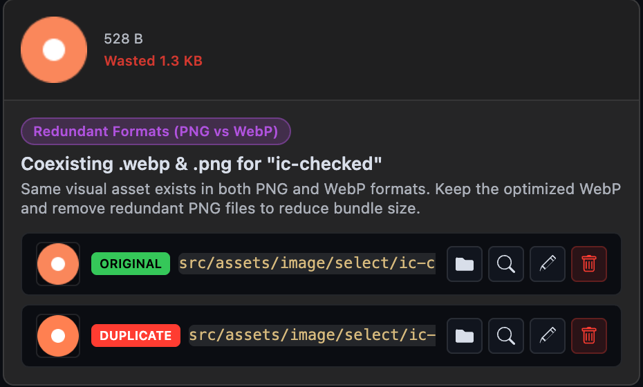
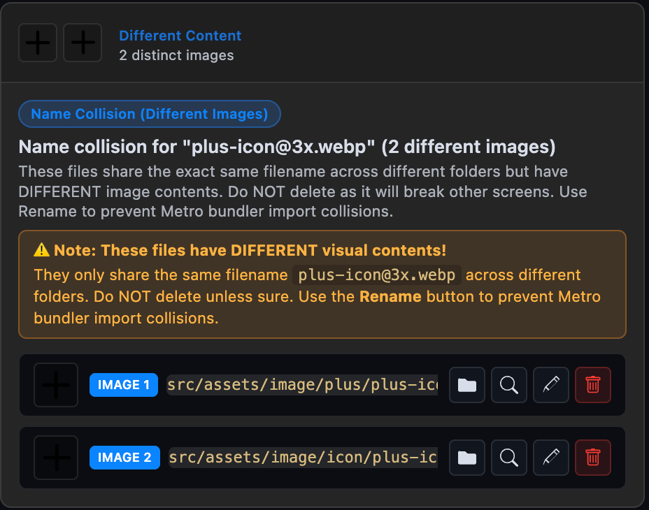

# React Native Asset & Icon Lens (`vscode-rn-asset-lens`)

<p align="center">
  
</p>

<p align="center">
  <b>Công cụ toàn diện tất-cả-trong-một cho lập trình viên React Native & Expo:</b><br />
  Tra cứu Icon offline cực nhanh, tự động import thông minh, xem trước ảnh khi rê chuột (kích thước, dung lượng, tỉ lệ @2x/@3x), thumbnail ở lề dòng code (gutter margin), quét ảnh trùng lặp 4 tiêu chí, kiểm tra không gian màu và bit depth, cảnh báo đường dẫn asset sai theo thời gian thực.
</p>

<p align="center">
  <a href="README.md"><b>English</b></a> | <b>Tiếng Việt</b>
</p>

---

## 🚀 Nỗi đau thực tế & Giải pháp (Problem & Solution)

| Nỗi đau của lập trình viên React Native | Giải pháp của `vscode-rn-asset-lens` |
| :--- | :--- |
| **Mất thời gian tra cứu Icon:** Phải mở trình duyệt, search trên trang web icons, copy tên icon, quay lại VS Code gõ `<Ionicons name="..." />` rồi thủ công thêm lệnh `import`. | **Icon Picker & QuickPick offline:** Nhấn <kbd>Cmd+Shift+I</kbd> mở Visual Icon Explorer hoặc <kbd>Cmd+Alt+I</kbd> để Quick Search. Chọn icon là **tự động chèn JSX component** và **tự động chèn/merge lệnh `import`** chuẩn xác! |
| **Mù thông tin ảnh khi code:** `require('./assets/logo.png')` không biết ảnh kích thước bao nhiêu (width x height), nặng bao nhiêu KB, có ảnh @2x @3x không. | **Image Hover Tooltip & Gutter Thumbnail:** Rê chuột qua bất kỳ `require('...')` hiển thị ngay **ảnh xem trước**, **kích thước Width × Height**, **dung lượng file**, format, và bảng chi tiết các scale variant (@1x, @2x, @3x). Đồng thời hiển thị thumbnail thu nhỏ trực tiếp ở lề dòng code (Gutter margin)! |
| **Ảnh chỉ có bản @2x/@3x hoặc tiền tố `@2x_`:** Thiết kế chỉ xuất file `@2x`/`@3x` hoặc đặt tên `@2x_icon.png`, code require `./icon.png` bị báo lỗi không tìm thấy. | **Smart Asset Resolution:** Tự động đối chiếu thông minh cả suffix (`icon@2x.png`), prefix (`@2x_icon.png`), và require bỏ đuôi mở rộng (`require('./icon')`) theo đúng chuẩn Metro bundler của React Native. |
| **Sai đường dẫn ảnh chỉ phát hiện lúc Crash Runtime:** Gõ nhầm `./assets/loggo.png`, app mở lên bị crash hoặc render ra khoảng trắng. | **Real-time Diagnostics & QuickFix:** Tự động gạch chân cảnh báo vàng khi file asset không tồn tại kèm gợi ý sửa lỗi chính tả (QuickFix: <kbd>Cmd+.</kbd>). |
| **Ảnh trùng lặp làm phình to Bundle size:** Copy ảnh qua nhiều folder hoặc lưu trùng PNG & WebP, scale giả @2x/@3x không tăng pixel. | **Duplicate Images Audit:** Quét tự động 4 tiêu chí (MD5, Trùng tên khác folder, Lỗi scale giả @2x/@3x, Trùng PNG vs WebP), hiển thị preview từng file, tìm kiếm code đang dùng bằng 1 click và đổi tên file trực tiếp. |
| **Crash trên Android vì ảnh CMYK / 16-bit:** File JPEG hệ màu in ấn CMYK hoặc PNG 16-bit gây crash `BitmapFactory` hoặc tràn RAM Android. | **Color & Bit Depth Audit:** Quét tự động phát hiện mọi ảnh CMYK và ảnh > 8-bit trên toàn bộ workspace, cảnh báo kịp thời trước khi release app. |

---

## ✨ Tính năng nổi bật (Key Features)

### 1. 🔍 Icon Picker Panel (Webview) & Keyboard QuickPick
- **Hỗ trợ hơn 15,000+ vector icons offline** từ tất cả các bộ icon phổ biến nhất:
  - `Ionicons` (bộ icon số 1 của Expo)
  - `MaterialCommunityIcons` (7,000+ icons)
  - `MaterialIcons` (Google Material)
  - `Feather`
  - `Lucide` (`lucide-react-native`)
  - `AntDesign`
  - `FontAwesome`, `FontAwesome 5`, `FontAwesome 6`
  - `Octicons` (GitHub Primer)
  - `Entypo`, `SimpleLineIcons`, `Foundation`, `EvilIcons`, `Zocial`
- **Visual Explorer Panel:**
  - Lọc theo từng Family hoặc tìm kiếm toàn bộ.
  - Tùy chỉnh trực tiếp Size (12px - 96px) và Color (color picker + swatches).
  - Tự chọn framework: **Expo (`@expo/vector-icons`)**, **React Native CLI (`react-native-vector-icons`)**, hoặc **Lucide (`lucide-react-native`)**.
- **Smart Auto-Import:**
  - Tự động phát hiện project dùng Expo hay React Native CLI thông qua `package.json`.
  - Nếu file code đã có `import { Feather } from '@expo/vector-icons'`, khi chèn `Ionicons` extension sẽ tự merge thành `import { Feather, Ionicons } from '@expo/vector-icons'`.
  - Nếu chưa có import, tự động chèn import mới vào đầu file code.

### 2. 🖼️ Image Hover Preview, Gutter Thumbnails & Scale Resolution
- **Rê chuột qua bất kỳ khai báo ảnh:**
  - `require('./assets/logo.png')`
  - `require('../images/banner.jpg')`
  - `require('@/assets/avatar.webp')` (hỗ trợ cả tsconfig `baseUrl` và `paths` alias!)
  - `source={{ uri: 'https://reactnative.dev/img/tiny_logo.png' }}`
- **Gutter Thumbnail Margin:** Hiển thị trực tiếp icon / thumbnail thu nhỏ ở lề số dòng (editor gutter) cạnh câu lệnh `require(...)` hoặc component `<Icon ... />`.
- **Hiển thị đầy đủ thông số kỹ thuật:**
  - Visual Image Preview trực quan.
  - **Kích thước thực tế:** `Width × Height px` (dùng thư viện phân tích header siêu nhanh `image-size`).
  - **Dung lượng file:** formatted `KB` / `MB`.
  - **Định dạng:** PNG, JPEG, SVG, WebP, GIF, BMP, v.v.
  - **Scale Variants Table:** Tự động phát hiện các file tỉ lệ màn hình React Native (`@1x`, `@2x`, `@3x`) trong cùng thư mục (hỗ trợ cả hậu tố `logo@2x.png` lẫn tiền tố `@2x_logo.png`) và bảng so sánh kích thước.
  - Action link: `Open File` & `Reveal in Finder/Explorer`.

### 3. ⚠️ Asset Path Diagnostics & Import Helper
- Tự động quét code JS/JSX/TS/TSX trong thời gian thực.
- Nếu đường dẫn file ảnh trong `require('...')` không tồn tại hoặc bị gõ sai:
  - Báo cảnh báo (warning squiggly line): `[RN Asset Lens] Asset file not found: "./assets/loggo.png"`.
  - Nhấn <kbd>Cmd+.</kbd> (hoặc <kbd>Ctrl+.</kbd>) để kích hoạt **QuickFix**:
    - Tự động gợi ý tên file đúng tương tự (fuzzy matching trong cùng thư mục).
    - Mở QuickPick duyệt toàn bộ ảnh trong project để thay thế.

### 4. ⚡ In-Editor Icon Hover & Auto-Completion (IntelliSense)
- Rê chuột vào thuộc tính `name="airplane"` trên `<Ionicons name="airplane" />` -> hiển thị tooltip với **Vector SVG được render trực tiếp**, thông tin Unicode và family!
- Khi gõ `name="` bên trong thẻ `<Ionicons name="` hoặc `<Feather name="` -> IntelliSense gợi ý danh sách toàn bộ icon hợp lệ kèm icon preview!
- Khi gõ `require('./assets/` -> IntelliSense gợi ý danh sách các file ảnh trong thư mục kèm kích thước Width x Height!

### 5. 🎯 Quick Asset Require Picker
- Lệnh: `React Native: Pick and Insert Asset require()`
- Quét nhanh toàn bộ ảnh trong workspace, hiện menu chọn kèm kích thước, bấm chọn là tự động tính toán đường dẫn relative path chính xác và chèn `require('./...')` vào vị trí con trỏ!

### 6. 🔍 Find Duplicate Images (Quét & Dọn Dẹp Ảnh Trùng Lặp 4 Tiêu Chí)
- Lệnh: `Command + Shift + P > React Native: Find Duplicate Images`

<p align="center">
  
  <br />
  <em>Giao diện Audit phát hiện ảnh trùng lặp cross-format (PNG vs WebP), tính dung lượng lãng phí và thao tác nhanh bằng icon toolbar.</em>
</p>

<p align="center">
  
  <br />
  <em>Cơ chế cảnh báo thông minh khi trùng tên khác thư mục nhưng khác nội dung ảnh: hiển thị thumbnail từng file và nút Đổi tên (✏️) an toàn.</em>
</p>

- **Quét toàn diện theo 4 tiêu chí:**
  1. **Exact Binary Match (MD5):** Băm MD5 để tìm ảnh giống nhau 100% từng byte dù khác tên hoặc nằm ở các thư mục khác nhau.
  2. **Name Collision (Trùng tên khác thư mục):** Tự động phát hiện và cảnh báo thông minh:
     - Nếu các file trùng tên nhưng **nội dung ảnh khác nhau**, extension sẽ cảnh báo rõ ràng *Khác nội dung*, hiển thị thumbnail riêng của từng file và **không tính lãng phí nhầm**, kèm nút **Đổi tên (Rename)** an toàn.
     - Nếu cùng nội dung, gắn nhãn bản sao để dọn dẹp.
  3. **Fake Scale @2x/@3x:** Phát hiện các file `@2x` hoặc `@3x` bị đổi tên thủ công mà không tăng độ phân giải (bằng hoặc nhỏ hơn `@1x`), làm mờ màn hình Retina và tốn dung lượng.
  4. **Cross-Format (PNG vs WebP):** Phát hiện cùng một tài nguyên hình ảnh nhưng tồn tại song song cả đuôi `.png` và `.webp`.
- **Hệ thống nút thao tác dạng Icon tiện lợi (Default English Tooltips):**
  - 📂 **Reveal**: Mở nhanh vị trí file trong Finder (macOS) hoặc File Explorer (Windows/Linux).
  - 🔍 **Find in Code**: Tìm kiếm tất cả vị trí code đang `require()` hoặc `import` ảnh (tự động loại bỏ `@2x`/`@3x` và tiền tố `@2x_` để tìm đúng câu lệnh trong code React Native).
  - ✏️ **Rename**: Đổi tên file trực tiếp trên giao diện để tránh xung đột tên trong Metro bundler.
  - 🗑️ **Delete**: Xóa nhanh file thừa với popup xác nhận an toàn.
- **Tự động loại trừ thư mục ngoài lề:** Bỏ qua hoàn toàn các thư mục không liên quan đến React Native như `vendor`, `Pods`, `build`, `.bundle`, `.gradle`, `.cxx`, `DerivedData`, `fastlane`, v.v. (có thể tùy chỉnh thêm trong Cài đặt).

### 7. 🎯 Find Duplicate Images with the Input Image (Kiểm Tra Trùng Lặp Cho 1 Ảnh Đầu Vào)
- **Cách sử dụng:**
  - Phím tắt: `Command + Shift + P` > `React Native: Find Duplicate Images with the Input Image` (mở hộp thoại chọn ảnh từ máy hoặc dự án).
  - Hoặc **Click chuột phải vào file ảnh** trong VS Code Explorer > chọn `React Native: Find Duplicate Images with the Input Image`.
- **Cơ chế đối chiếu thông minh:**
  1. **Exact Binary Match (MD5):** Trùng khớp 100% từng byte với ảnh đã có trong workspace dù khác tên hay vị trí thư mục.
  2. **Cross-Format Duplicate:** Cùng asset nhưng đã có sẵn định dạng tối ưu hơn (ví dụ: đưa vào `.png` nhưng dự án đã có sẵn `.webp`).
  3. **Same Filename Collision:** Trùng tên file với ảnh ở thư mục khác (phòng ngừa lỗi Metro bundler nhầm lẫn asset).
  4. **Scale Variant Match:** Phát hiện ảnh đưa vào đã tồn tại phiên bản tỉ lệ `@2x` hoặc `@3x`.
- **Truy vết chính xác vị trí trong Code:**
  - Tự động quét toàn bộ mã nguồn (`.js`, `.jsx`, `.ts`, `.tsx`, `.json`) để tìm tất cả các file đang sử dụng tài nguyên này.
  - Hiển thị **File : Số dòng** (ví dụ: `src/screens/Home.tsx:42`) kèm đoạn mã thực tế.
  - **Click trực tiếp vào dòng code** để mở file và trỏ ngay tới đúng dòng trong editor!
- **Giới hạn an toàn dung lượng ảnh đầu vào:**
  - Tự động kiểm tra kích thước file ảnh đưa vào (mặc định tối đa 15 MB, tùy chỉnh qua `rnAssetLens.maxInputImageSizeMB`).
  - Hiển thị hộp thoại cảnh báo nếu ảnh vượt quá giới hạn nhằm bảo vệ hiệu năng, tránh tốn RAM và đơ máy.
- **Tự động đóng tab khi Reload / Reset Window:**
  - Khi reload cửa sổ (`Developer: Reload Window`), toàn bộ các tab audit (`Duplicate Images`, `Input Image Duplicates`, `Color & Bit Depth`) sẽ tự động đóng sạch sẽ, ngăn ngừa tình trạng tab rác bị mất dữ liệu tham chiếu trong bộ nhớ.
- **Bộ công cụ thao tác nhanh:** Hỗ trợ đầy đủ 4 nút icon 📂 Reveal, 🔍 Find in Code, ✏️ Rename, 🗑️ Delete ngay trên giao diện kết quả.

### 8. 🎨 Audit Image Bit Depth & Color Space (Kiểm Tra Bit Màu & Không Gian Màu)
- Lệnh: `Command + Shift + P > React Native: Audit Image Bit Depth & Color Space`
- Quét và phát hiện các rủi ro màu sắc làm crash hoặc vỡ giao diện trên Android / iOS:
  - ❌ **CMYK JPEGs (Print Mode):** React Native trên Android sẽ **bị crash** hoặc hiển thị màu âm bản (inverted/black) khi gặp ảnh CMYK. Extension phát hiện và cảnh báo ngay lập tức!
  - ⚠️ **16-bit PNG/JPEG (> 8-bit per channel):** Gây tràn bộ nhớ (memory spike) hoặc lỗi `BitmapFactory` trên nhiều thiết bị Android.
  - ✅ **8-bit sRGB:** Chuẩn hiển thị tối ưu nhất cho React Native.
- Cảnh báo trực tiếp trong **Hover Preview** và gạch chân vàng cảnh báo trong code editor khi dev require file ảnh bị lỗi màu.

---

## ⌨️ Phím tắt mặc định (Keyboard Shortcuts)

| Phím tắt (Mac) | Phím tắt (Windows/Linux) | Lệnh | Mô tả |
| :--- | :--- | :--- | :--- |
| <kbd>Cmd + Shift + I</kbd> | <kbd>Ctrl + Shift + I</kbd> | `rn-asset-lens.openIconPicker` | Mở giao diện Visual Icon Explorer Panel (Webview) |
| <kbd>Cmd + Alt + I</kbd> | <kbd>Ctrl + Alt + I</kbd> | `rn-asset-lens.quickPickIcon` | Mở thanh Quick Search & Insert Icon cực nhanh |
| Context Menu | Context Menu | `rn-asset-lens.insertAssetRequire` | Chèn `require('./...')` từ danh sách ảnh dự án |

*Lưu ý: Bạn có thể click trực tiếp vào nút **RN Asset Lens** ở góc dưới thanh trạng thái (Status Bar) để mở menu thao tác nhanh!*

---

## ⚙️ Cấu hình cài đặt (Extension Settings)

Bạn có thể tùy chỉnh trong VS Code Settings (`Preferences -> Settings -> search "rnAssetLens"`):

```json
{
  // Tự động phát hiện hoặc ép buộc dùng framework nào: "auto" | "expo" | "react-native-vector-icons" | "lucide"
  "rnAssetLens.preferredFramework": "auto",

  // Kích thước mặc định của icon prop JSX (mặc định: 24)
  "rnAssetLens.defaultIconSize": 24,

  // Màu sắc mặc định của icon JSX (mặc định: "black")
  "rnAssetLens.defaultIconColor": "black",

  // Bật/tắt xem trước ảnh khi rê chuột
  "rnAssetLens.enableAssetHoverPreview": true,

  // Bật/tắt xem trước icon khi rê chuột
  "rnAssetLens.enableIconHoverPreview": true,

  // Bật/tắt thumbnail xem trước ảnh ở lề dòng code (gutter margin)
  "rnAssetLens.enableGutterPreview": true,

  // Bật/tắt icon xem trước ở lề dòng code (gutter margin)
  "rnAssetLens.enableIconGutterPreview": true,

  // Bật/tắt cảnh báo đường dẫn asset không tồn tại
  "rnAssetLens.enableAssetDiagnostics": true,

  // Bật/tắt gợi ý tự động cho đường dẫn asset
  "rnAssetLens.enableAssetAutocomplete": true,

  // Bật/tắt gợi ý tên icon trong JSX
  "rnAssetLens.enableIconAutocomplete": true,

  // Danh sách các định dạng nhận diện là file asset
  "rnAssetLens.assetExtensions": [
    ".png", ".jpg", ".jpeg", ".gif", ".webp", ".svg", ".bmp", ".ico", ".ttf", ".otf", ".mp4", ".json"
  ],

  // Dung lượng tối đa (MB) cho ảnh đầu vào khi kiểm tra trùng lặp (mặc định: 15)
  "rnAssetLens.maxInputImageSizeMB": 15,

  // Danh sách các thư mục bỏ qua khi quét ảnh trong workspace
  "rnAssetLens.ignoredFolders": [
    "**/node_modules/**", "**/vendor/**", "**/.bundle/**", "**/Pods/**", "**/build/**",
    "**/.expo/**", "**/.expo-shared/**", "**/dist/**", "**/out/**", "**/coverage/**",
    "**/fastlane/**", "**/DerivedData/**", "**/android/build/**", "**/android/app/build/**",
    "**/ios/build/**", "**/ios/Pods/**", "**/.gradle/**", "**/.cxx/**", "**/.git/**",
    "**/.svn/**", "**/.hg/**", "**/.cache/**"
  ]
}
```

---

## 🛠️ Cấu trúc dự án (Architecture)

```
vscode-rn-asset-lens/
├── assets/
│   ├── icon.png                 # Extension logo
│   ├── fonts/                   # 20 TTF vector icon fonts (Ionicons, Lucide, Material, etc.)
│   └── glyphmaps/               # JSON codepoint maps for 15,000+ icons
├── src/
│   ├── extension.ts             # Extension activation, status bar, command registry
│   ├── constants.ts             # Icon families metadata, regexes, supported extensions
│   ├── types.ts                 # TypeScript interfaces
│   ├── icons/
│   │   ├── iconRegistry.ts      # Offline glyphmap parser & OpenType vector SVG generator
│   │   ├── importHelper.ts      # Framework detection & smart import merging
│   │   ├── iconHoverProvider.ts # In-editor JSX hover preview tooltip
│   │   ├── iconCompletionProvider.ts # IntelliSense for icon name props
│   │   ├── iconPickerPanel.ts   # Webview visual explorer controller
│   │   └── iconQuickPick.ts     # Fast keyboard search & insertion
│   ├── assets/
│   │   ├── assetUtils.ts        # Image dimensions, density scale detection (@2x, @3x, prefix @2x_)
│   │   ├── assetHoverProvider.ts# Hover preview for require() and remote URLs
│   │   ├── assetGutterProvider.ts# Gutter margin thumbnail preview
│   │   ├── assetDiagnostics.ts  # Real-time broken asset path warnings
│   │   ├── assetCodeActionProvider.ts # QuickFix suggestions for typos
│   │   ├── assetDefinitionProvider.ts # Cmd+Click jump to asset file
│   │   ├── assetCompletionProvider.ts # Asset path autocomplete
│   │   ├── assetPicker.ts       # Pick & insert relative require()
│   │   ├── pathFilterUtils.ts   # Exclude non-RN dirs (vendor, pods, build, etc.)
│   │   ├── imageAuditUtils.ts   # Multi-criteria duplicate scanner & color depth auditor
│   │   ├── duplicateFinderPanel.ts # Duplicate audit panel controller
│   │   ├── inputImageFinderPanel.ts# Find duplicates for specific input image
│   │   └── colorAuditPanel.ts   # Color & bit depth audit panel controller
│   └── webview/
│       ├── iconPickerHtml.ts    # Native VS Code themed HTML/CSS/JS for Icon Explorer
│       ├── duplicateFinderHtml.ts# Audit report HTML with icon toolbars & per-file previews
│       ├── inputImageFinderHtml.ts# Single input image audit report HTML with code references
│       └── colorAuditHtml.ts    # Color space & bit-depth inspection report HTML
└── test/
    ├── fixtures/                # Sample React Native component & test images
    └── unit.test.mjs            # Automated test suite (100% pass)
```

---

## 📦 Hướng dẫn cài đặt & sử dụng (Installation & Usage)

### Cài đặt từ file `.vsix`:
1. Trong VS Code, mở tab **Extensions** (<kbd>Cmd+Shift+X</kbd>).
2. Click vào icon `...` (Views and More Actions) ở góc trên bên phải.
3. Chọn **Install from VSIX...**.
4. Chọn file `vscode-rn-asset-lens-1.1.0.vsix`.

### Dành cho nhà phát triển (Development):
```bash
# Cài đặt dependencies
npm install

# Kiểm tra kiểu dữ liệu (TypeScript)
npm run compile

# Chạy build bundle tối ưu
npm run build

# Chạy unit tests
npm test

# Đóng gói VSIX
npm run package
```

---

## 📄 License
MIT License. Tự do sử dụng trong các dự án cá nhân và doanh nghiệp.
